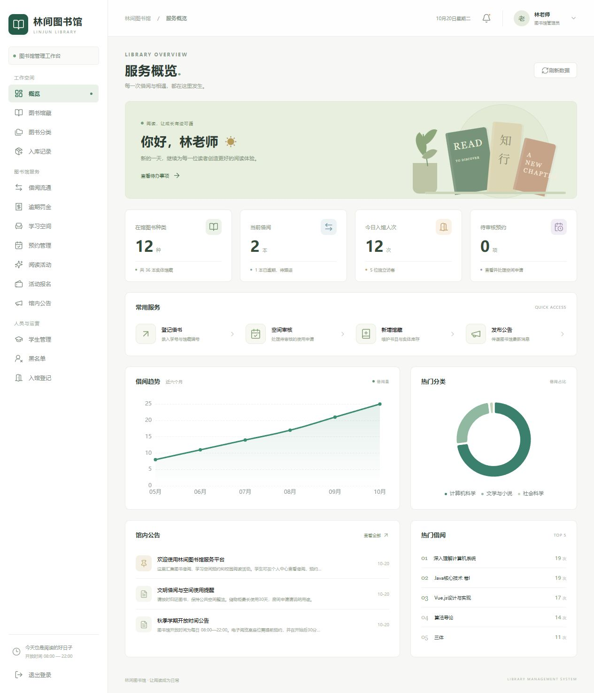

# 林间图书馆管理系统

Java 21 + Spring Boot 2.7.18 + Vue 3 + MySQL 的前后端分离课程作业。涵盖图书借还、空间预约、活动公告、学生与权限、入馆登记及运营统计。

界面分为管理员工作台和学生服务端。所有演示人物、账号、访客及历史借阅数据均为课程演示数据。首次在空数据库启动时自动初始化。



## 技术栈

| 层级 | 技术 |
| --- | --- |
| Java | JDK 21 |
| 后端 | Spring Boot 2.7.18、MyBatis-Plus 3.5.7、Spring JDBC |
| 前端 | Vue 3、Vite、Element Plus、Pinia、Vue Router、Axios |
| 图表 | ECharts |
| 数据库 | MySQL 8.0+；本机验证使用 MySQL 9.2 |
| 测试 | JUnit 5、MockMvc、H2 MySQL 模式，以及本机 MySQL 验证 |

需求表指定 Spring Boot 2.x；本项目选用其中支持 Java 21 的 2.7.18，保留 `javax.validation` 等 2.x 写法。

## 运行

需要 Java 21、Node.js 18+、MySQL 8.0+，在 PowerShell 中进入项目根目录。

**本机已由开发过程配置数据库的环境：**

```powershell
./env/scripts/build.ps1
./env/scripts/start.ps1
```

打开 <http://localhost:8080>。打包时将前端构建输出复制到后端静态目录，因此启动一个 Java 进程即可演示完整系统。源码仍按前后端分离组织，开发时支持独立启动。

**新电脑首次初始化：**

```powershell
# mysql.exe 需要在 PATH 中；按提示输入本机 MySQL root 密码
./env/scripts/setup-database.ps1
./env/scripts/build.ps1
./env/scripts/start.ps1
```

数据库初始化脚本创建独立数据库 `linjun_library` 和专用用户 `linjun_app`，本地连接信息保存到根目录 `config.yaml`。如果已存在同名用户，可手动使用已有密码填写配置。脚本保留已有配置。

也可以手动创建数据库，执行 `env/sql/schema.sql`，复制 `env/config.example.yaml` 为 `config.yaml` 并填入数据库连接。建表脚本的索引定义只应在首次初始化时执行。

停止本项目启动的 Java 进程：

```powershell
./env/scripts/stop.ps1
```

构建脚本会使用本机 Maven；没有 Maven 时从 Maven Central 下载 3.9.9 到被 Git 忽略的 `env/tools/`。数据库密码、依赖目录、运行日志和构建产物均排除在 Git 之外。

## 演示账号

初始密码均为 `Library123!`。可在个人中心修改，修改后所有会话失效；也可以在第一次初始化前通过 `library.demo-password` 设置其他演示初始密码。

| 角色 | 账号 |
| --- | --- |
| 超级管理员 | `superadmin` |
| 管理员 | `admin` |
| 学生 | `2026001` ～ `2026005` |

演示图书共有 12 种、36 本实体馆藏，配有分类、历史借阅、在借和逾期记录、8 个电子阅览座位、6 个储物柜、3 个房间及3场活动。活动日期在首次初始化时设为接下来几天，可通过管理页面调整。

## 功能

| 模块 | 实现内容 |
| --- | --- |
| 账号与权限 | 三种角色、账号启停、学生维护、Excel 导入、修改密码、接口权限及数据归属校验 |
| 黑名单 | 加入和移出、保留原因与历史、拦截新增借阅、空间预约及入馆；允许还书 |
| 图书馆藏 | 分类、书目维护、ISBN 检索、实体馆藏编号、分页筛选、停用及入库记录 |
| 借阅流通 | 按学生与馆藏编号借书、按记录或馆藏编号还书、库存校验、到期筛选、逾期罚金、线下处理登记 |
| 储物柜 | 期限申请、审核、冲突校验、到期自动结束并释放 |
| 电子阅览座位 | 按日期时间段预约、冲突校验、到馆签到、超时取消、违约记录 |
| 场馆房间 | 用途与社团信息、审核、时间冲突校验、与活动占用联动 |
| 阅读活动 | 发布与编辑、人数上限、报名防重复、取消报名、名单查询、现场核销 |
| 公告 | 发布、编辑、置顶、删除、首页与历史列表展示 |
| 运营统计 | 入馆人次、去重人数、按日查访客、月度借阅趋势、热门书目、分类占比 |

刷卡、扫码通过输入学号或馆藏编号模拟；标准扫码枪可作为键盘输入设备。学生入馆在顶部点击“入馆登记”，管理员也可登记学生或校外访客。访客使用课程演示登记编号，无需采集真实证件信息。逾期提醒在列表与首页展示，罚金保留记录并支持线下处理登记。

## 业务规则

- 默认借阅30天，最多同时借阅5本；逾期按每开始一天0.50元计算。
- 图书资料与实体馆藏分表，同一 ISBN 可有多本实体书；可借数量根据实体书状态查询。
- 借还书使用数据库事务和行锁。重复还书被拦截，同一本实体书只会成功借出一次。
- 座位预约在同一天内最长4小时，预约开始后30分钟内签到。定时任务每分钟检查一次，超时未签到记录一次违约。
- 储物柜最长30天；储物柜、房间申请审核通过后占用对应时段。
- 预约区间按 `[开始时间, 结束时间)` 检查，相邻时段可预约。活动与房间预约共享冲突校验。
- 空间开放/维护状态与预约占用分开维护，未来预约不会导致当前时段被错误锁定。
- 黑名单保留已有预约历史，但拦截新的预约和座位签到；管理人员可取消尚未使用的有效预约。
- 活动报名在活动开始前开放，报名与容量检查在事务中完成；现场核销允许活动开始前30分钟至结束。
- 学生只可查询和操作本人借阅、预约、报名及罚金。管理员账号管理仅对超级管理员开放。

时间、罚金、签到宽限和借阅数量在 `config.yaml` 的 `library` 节点配置。账号初次初始化后更改演示密码配置不会重置已有密码。

## 目录

```text
back/
  src/main/java/edu/linjun/library/
    controller/          接口与参数入口
    service/             业务接口
      impl/              业务实现与事务
    mapper/              MyBatis-Plus BaseMapper
    entity/              数据库实体
    dto/                 登录等请求对象
    vo/                  分页响应
    common/              统一响应、异常、用户上下文及SQL辅助
    config/              认证拦截器、演示数据初始化
    task/                预约到期任务
front/src/
  api/                   接口封装
  components/            共享组件
  config/                页面字段与列表定义
  router/                路由
  stores/                登录状态
  views/                 登录、布局、首页、业务页、个人中心
env/
  sql/                   MySQL建表脚本
  scripts/               初始化、构建、启动、停止函数脚本
  config.example.yaml    无真实密码的配置示例
config.yaml              本地配置，不提交Git
test/
  round_001_backend/     自动化测试源码
  round_*/               分轮测试结果和记录
docs/                    数据库与答辩说明
```

基础增删改查由 MyBatis-Plus Mapper 完成；联表查询、统计和需要显式行锁的流程使用 Spring JDBC。业务中的动态SQL仅使用代码内的固定模块白名单，用户输入使用参数绑定。账号、图书和资源采用停用或关闭，保留业务历史。

## 独立开发和测试

在IDE中运行 `LibraryApplication` 时，将工作目录设为项目根目录；也可以在项目根目录运行：

```powershell
./env/tools/apache-maven-3.9.9/bin/mvn.cmd -f back/pom.xml spring-boot:run
```

前端独立开发：

```powershell
cd front
npm ci
npm run dev
```

打开 <http://localhost:5173>；Vite 把 `/api` 代理到后端8080端口。生产页面修改先改 `front/src`，再运行构建脚本。

自动化测试源码放在 `test/round_001_backend/src`，Maven 已配置此目录为测试源码目录。测试使用独立 H2 内存数据库，不连接日常 MySQL 数据库。每次完整构建会新建带时间戳的测试子目录：

```powershell
./env/scripts/build.ps1
```

已覆盖登录、角色权限、数据归属、借还库存、重复还书、逾期罚金、黑名单、预约冲突、签到超时、设备损坏、活动占用、活动限额、导入原子性、密码失效以及并发抢座、借书和报名。具体执行结果见 `test/TEST_REPORT.md`。

## 交付与答辩

建议按“入库 → 图书查询 → 借书 → 学生查看借阅 → 还书 → 预约 → 审核 → 活动报名 → 入馆与统计”的顺序演示。

数据库关系与接口见 [开发说明](docs/DEVELOPMENT.md)，功能与需求对应关系见 [验收清单](docs/ACCEPTANCE.md)。GitHub 提供源码托管；完整业务需要运行 Java 和 MySQL，可在本机通过8080端口访问。
