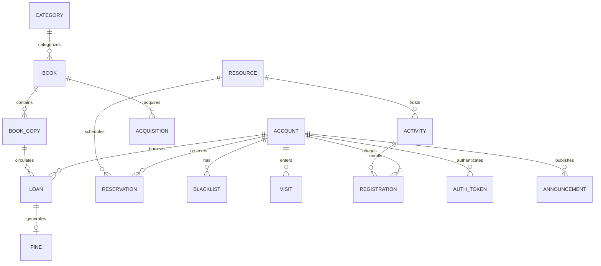

# 开发说明与数据库设计

## 数据库关系

数据库共有15张表，其中资源表 `resource` 用 `kind` 区分座位、储物柜和房间。预约表 `reservation` 复用申请人、时间区间和审核状态；不同类型的校验位于业务层。

| 表 | 用途 | 关键约束 |
| --- | --- | --- |
| account | 三类用户、学生资料 | username、student_no唯一；密码只存BCrypt哈希 |
| category | 图书分类 | 分类名唯一 |
| book | 书目资料 | ISBN唯一，关联分类 |
| book_copy | 实体馆藏 | code唯一，关联book |
| acquisition | 入库批次 | 数量、来源、操作人 |
| loan | 借阅历史 | 用户、实体馆藏、借还日期、状态 |
| fine | 逾期费用 | 每条loan至多一条罚金 |
| blacklist | 黑名单历史 | 原因、启用标记、操作人 |
| resource | 空间资源 | kind、code唯一、容量和维护状态 |
| reservation | 空间使用申请 | 时间区间、状态、审核人与违约标记 |
| activity | 活动安排 | 房间、时间、容量、开放状态 |
| registration | 报名记录 | activity_id与user_id组合唯一 |
| announcement | 公告 | 作者、置顶标记、内容 |
| visit | 入馆流水 | 学生或访客登记编号、入馆时间 |
| auth_token | 登录会话 | 仅保存Token的SHA-256摘要、用户和有效期 |

完整字段、索引和外键以 `env/sql/schema.sql` 为准。

## 分层职责

- `AuthController` → `AuthService` → `AuthServiceImpl`：登录、会话、修改密码。
- `CatalogController` → `CatalogService` → `CatalogServiceImpl`：固定业务模块的分页查询、管理表单和权限控制。
- `WorkflowController` → `WorkflowService` → `WorkflowServiceImpl`：借还、入库、预约审核、报名核销及入馆。
- `Mapper`：各实体对应一个MyBatis-Plus `BaseMapper`。
- `Database`：参数化联表查询、显式事务行锁所需SQL、生成主键与列名转换。
- `ReservationExpiryTask`：每60秒调用预约清理业务。

基础CRUD只允许各模块白名单字段；学生账号创建时角色固定为STUDENT，管理员创建时固定为ADMIN。请求里的角色、密码哈希、库存等越权字段不会直接写库。

## 主要接口

所有业务结果使用 `{success,message,data}`。失败使用对应HTTP状态码，前端统一展示消息。除登录和健康检查外均需要 `Authorization: Bearer <token>`。

| 方法 | 路径 | 用途 |
| --- | --- | --- |
| POST | /api/auth/login | 账号密码登录 |
| GET | /api/auth/me | 当前用户 |
| POST | /api/auth/logout | 删除当前会话 |
| POST | /api/auth/password | 修改密码并撤销所有会话 |
| GET | /api/dashboard | 按角色返回首页统计 |
| GET | /api/options | 表单可用书目、分类、资源和学生 |
| GET | /api/data/{module} | 分页查询，支持q/page/size和对应业务筛选 |
| POST | /api/data/{module} | 创建可维护实体 |
| PUT | /api/data/{module}/{id} | 更新白名单字段 |
| DELETE | /api/data/{module}/{id} | 删除、停用或关闭 |
| POST | /api/actions/{action} | 执行专用业务流程 |
| GET | /api/resources/{id}/availability | 查看未来占用区间，不返回申请人身份 |
| GET | /api/students/template | 下载xlsx导入模板 |
| POST | /api/students/import | 上传xlsx，先校验再原子导入 |

`module`：students、administrators、categories、books、copies、acquisitions、loans、fines、blacklist、resources、reservations、activities、registrations、announcements、visits。

`action`：acquire、borrow、return、blacklist-add、blacklist-remove、reserve、review、reservation-cancel、reservation-checkin、register、registration-cancel、activity-checkin、visit、fine-settle。

新增、编辑只开放给 accounts对应的管理模块、categories、books、resources、activities、announcements；借阅、罚金、预约、黑名单、入库、报名、入馆流水均通过业务动作生成，保证状态校验。

## 事务与状态

借书锁定学生账号和实体馆藏，校验账号、黑名单及最大在借数量，然后生成借阅记录并修改馆藏状态。还书锁定借阅记录，仅允许BORROWED转为RETURNED，并恢复实体馆藏；罚金使用loan唯一约束防重。

资源预约及审核锁定对应资源记录，以序列化同一资源的占用检查。座位创建后为APPROVED；房间和储物柜创建后为PENDING，审核通过转为APPROVED，拒绝转为REJECTED。开始后的座位签到转为CHECKED_IN，未签到超时转为EXPIRED并记录一次违约；已使用时段结束转为COMPLETED。

活动报名锁定学生和活动，校验活动时间、是否已报名和剩余名额。取消报名保留记录，后续可重新报名。活动现场核销转为CHECKED_IN。

## 答辩示例

1. 用superadmin登录，查看管理员账号管理；普通admin没有这一入口。
2. 在图书馆藏查看《深入理解计算机系统》的实体编号，或新增图书并入库。
3. 借书登记选择2026001和可借编号，例如LJ-001-02；切换学生查看本人借阅。
4. 管理员登记还书；对初始化中的逾期图书LJ-002-01还书，查看罚金并登记线下处理。
5. 学生预约房间的未来空闲时段，管理员审核；用另一学生申请冲突时段验证拦截。
6. 查看座位预约、储物柜期限，以及活动报名和人数上限。
7. 管理员将学生加入黑名单，验证其入馆、借阅和预约被拦截；还书仍可办理。
8. 展示公告置顶、今日入馆人次与去重人数、六个月借阅趋势和分类图表。

初始馆藏在日常演示后可能已被借出，按详情中的实时状态选择编号即可。
